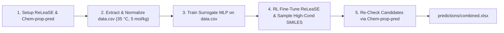

# RL-Inverse-PEO-Design

**Reinforcement-Learning-Driven Inverse Design of High-Conductivity PEO-Based Polymer Electrolytes**

## About

This repository provides the reproduction workflow, submodule links, and final generated polymer electrolyte dataset for the inverse design of poly(ethylene oxide) (PEO)-derived solid polymer electrolytes using deep reinforcement learning.

Starting from experimental polymer electrolyte data curated in [**Chem-prop-pred / ChemArr**](https://github.com/learningmatter-mit/Chem-prop-pred), ionic conductivities are standardized to a common reference state (**35 °C** and **5 mol kg⁻¹** salt concentration) and used to train a fast multi-layer perceptron (MLP) surrogate reward model. This surrogate guides the reinforcement learning (RL) fine-tuning of the [**ReLeaSE**](https://github.com/isayev/ReLeaSE) generative RNN to propose high-conductivity polymer structures, which are subsequently re-evaluated using the physics-informed **Chem-prop-pred (ChemArr)** model.

The final generated candidates and ChemPropPred-verified conductivity predictions (`25,338` entries) are available in [`predictions/combined.xlsx`](./predictions/combined.xlsx).

---

## Repository Structure

```text
RL-Inverse-PEO-Design/
├── ReLeaSE/                     # Linked GitHub submodule: isayev/ReLeaSE
├── Chem-prop-pred/              # Linked GitHub submodule: learningmatter-mit/Chem-prop-pred (includes ChemArr)
├── step4.py                     # Surrogate MLP training & SMILES -> RDKit descriptors -> conductivity prediction
├── step5.py                     # ReLeaSE RL fine-tuning & high-conductivity polymer SMILES generation
├── predictions/
│   └── combined.xlsx            # Final RL-generated polymer SMILES & ChemPropPred conductivity predictions
└── README.md                    # Pipeline overview, setup & reproduction instructions
```

---

## End-to-End Reproduction Workflow



### Step 1: Set Up `ReLeaSE`

Clone [`ReLeaSE`](https://github.com/isayev/ReLeaSE) (linked in [`ReLeaSE/`](./ReLeaSE)) and follow the installation and environment setup instructions in [`ReLeaSE/README.md`](./ReLeaSE/README.md).

---

### Step 2: Set Up `Chem-prop-pred` and `ChemArr`

Set up [`Chem-prop-pred`](https://github.com/learningmatter-mit/Chem-prop-pred) (linked in [`Chem-prop-pred/`](./Chem-prop-pred)), including initializing `ChemArr` and installing the required dependencies, by following the instructions in [`Chem-prop-pred/README.md`](./Chem-prop-pred/README.md).

---

### Step 3: Extract and Standardize `data.csv` (`SMILES, COND`)

Construct the standardized training dataset `data.csv` with columns `(SMILES, COND)` from the `Chem-prop-pred` electrolyte dataset (`Chem-prop-pred/data/`):

- **Reference Conditions:** All ionic conductivity values are normalized to a common reference state of **35 °C** and a salt concentration of **5 mol kg⁻¹**.
- **ChemArr Imputation for Missing Reference Measurements:** Whenever direct experimental measurements at exactly **35 °C** and **5 mol kg⁻¹** are unavailable for a polymer system, conductivity at the reference state is estimated from neighboring experimental data within the available temperature and concentration ranges using the pretrained **ChemArr** model.

---

### Step 4: Train the Surrogate MLP Conductivity Model ([`step4.py`](./step4.py))

Using the standardized `data.csv` (`SMILES, COND`) from Step 3, train the multi-layer perceptron (`MLPRegressor`, hidden layers `(200, 150, 100, 50)`) mapping 12 RDKit molecular descriptors of polymer SMILES to ionic conductivity at the reference state (see [`step4.py`](./step4.py)). This lightweight MLP serves as a fast reward oracle during reinforcement learning.

---

### Step 5: RL Fine-Tuning in `ReLeaSE` ([`step5.py`](./step5.py)) & Final Verification with `Chem-prop-pred`

1. **Fine-Tune the `ReLeaSE` Generative Model ([`step5.py`](./step5.py)):**
   - Using the trained MLP conductivity predictor as the RL reward function, fine-tune the pretrained `ReLeaSE` stack-augmented RNN generator to bias generation toward high-conductivity PEO-like polymer structures (see [`step5.py`](./step5.py)).
   - Refer to the source modules in [`ReLeaSE/release/`](./ReLeaSE/release) and the demonstration notebooks inside [`ReLeaSE/`](./ReLeaSE) (e.g., [`LogP_optimization_demo.ipynb`](./ReLeaSE/LogP_optimization_demo.ipynb) and [`JAK2_min_max_demo.ipynb`](./ReLeaSE/JAK2_min_max_demo.ipynb)) for changes and debugging.
   - Sample and store the generated high-conductivity candidate SMILES strings.

2. **Re-Check Generated Polymers with `Chem-prop-pred`:**
   - Evaluate the stored high-conductivity candidate SMILES using the trained **Chem-prop-pred (`ChemArr`)** model to obtain final physics-informed Arrhenius conductivity predictions across target temperatures.

3. **Final Predictions Dataset:**
   - All compiled candidate polymer electrolyte formulations and their final ChemPropPred-verified predictions are stored in **[`predictions/combined.xlsx`](./predictions/combined.xlsx)** (`25,338` rows; columns: `smiles`, `temperature`, `preds`).

---

## Final Data Availability

The final generated and ChemPropPred-rechecked dataset is located at:

- **[`predictions/combined.xlsx`](./predictions/combined.xlsx)** — Contains `25,338` evaluated polymer–salt (`LiTFSI`) SMILES entries (`smiles`), evaluation temperatures (`temperature`), and ChemPropPred predicted log ionic conductivities (`preds`).

---

## Credits & Acknowledgments

This work builds directly upon two open-source frameworks and their accompanying datasets and pretrained models. We gratefully credit and acknowledge the authors of both repositories:

1. **[ReLeaSE (`isayev/ReLeaSE`)](https://github.com/isayev/ReLeaSE)** — *Reinforcement Learning for Structural Evolution* (MIT License, Copyright © 2018 University of North Carolina and Contributors):
   > Popova, M.; Isayev, O.; Tropsha, A. Deep reinforcement learning for de novo drug design. *Science Advances* **2018**, *4* (7), eaap7885. DOI: [10.1126/sciadv.aap7885](https://doi.org/10.1126/sciadv.aap7885)

2. **[Chem-prop-pred (`learningmatter-mit/Chem-prop-pred`)](https://github.com/learningmatter-mit/Chem-prop-pred) & [ChemArr (`learningmatter-mit/ChemArr`)](https://github.com/learningmatter-mit/ChemArr)** — *Arrhenius-Informed Message Passing Neural Networks for Polymer Electrolytes* (MIT License, Copyright © 2022–2023 Learning Matter @ MIT):
   > Bradford, G.; Lopez, J.; Ruza, J.; Stolberg, M. A.; Osterude, R.; Johnson, J. A.; Gómez-Bombarelli, R.; Shao-Horn, Y. Chemistry-Informed Machine Learning for Polymer Electrolyte Discovery. *ACS Central Science* **2023**, *9* (2), 206–216. DOI: [10.1021/acscentsci.2c01123](https://doi.org/10.1021/acscentsci.2c01123)
